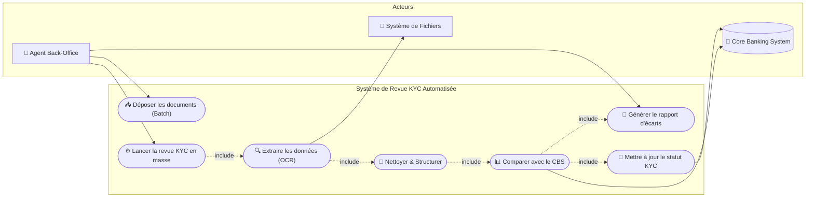
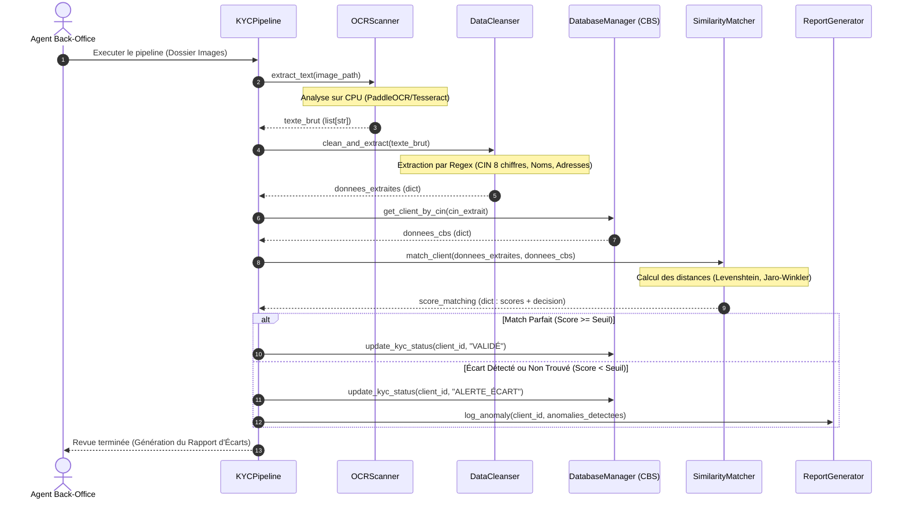
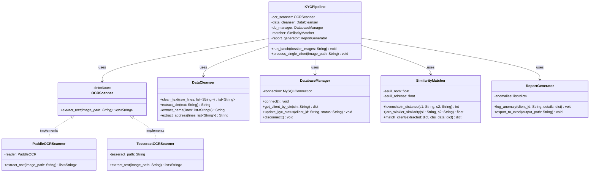

# Architecture Globale et Conceptuelle du Projet PFE KYC

Ce document détaille l'architecture logicielle, les diagrammes de conception (UML) et le flux de traitement de notre solution d'automatisation de la revue KYC.

---

## 1. Choix d'Outils de Modélisation dans Antigravity

Pour concevoir et éditer des diagrammes dans votre environnement de développement :
1.  **Mermaid (Intégré aux fichiers Markdown) [Recommandé] :** Permet de générer des diagrammes UML (Classes, Séquences, Cas d'utilisation, Architecture) directement à partir de texte. Les diagrammes s'affichent automatiquement de manière visuelle dans votre éditeur de code et dans le rapport final de PFE.
2.  **Excalidraw (Serveur MCP) :** Pour concevoir des schémas d'architecture personnalisés sous forme de croquis à main levée à l'aide des outils du MCP `excalidraw`.
3.  **Generate Image (`generate_image`) :** Pour concevoir des maquettes graphiques d'interfaces utilisateurs si nécessaire.

---

## 2. Diagramme de Cas d'Utilisation (Use Case Diagram)

Ce diagramme montre les interactions entre l'Agent Back-Office (utilisateur), le pipeline automatique et le Core Banking System (CBS).

---

## 3. Diagramme de Séquence (Sequence Diagram)

Ce diagramme montre l'échange de messages et le flux de données chronologique entre les différents modules lors de la revue d'un dossier.

---

## 4. Diagramme de Classes (Class Diagram)

Modélisation orientée objet du code Python du MVP pour garantir sa modularité et sa maintenabilité (Clean Architecture).

---

## 5. Architecture Technique Logique (N-Tier)

La solution suit une architecture en 3 couches (On-Premise) :

1.  **Couche Présentation / Commande (Interface) :**
    *   Script en ligne de commande (`pipeline_kyc.py`) permettant de lancer les revues en lot ou à l'unité.
    *   Génération de rapports Excel/PDF finaux pour les équipes de conformité Back-Office.
2.  **Couche Métier / Traitement (Logic/Processing Layer) :**
    *   **Moteur OCR (PaddleOCR) :** Tourne sur CPU local pour extraire le texte.
    *   **Module de Cleansing (Regex) :** Extrait et structure les variables KYC tunisiennes.
    *   **Module de Matching :** Calcule les écarts de similarité de chaînes de caractères.
3.  **Couche d'Accès aux Données (Storage/Database Layer) :**
    *   **MySQL Database (Core Banking System simulé) :** Stocke les tables clients, comptes, et statuts KYC.

---

## 6. Schéma Visuel de l'Architecture Technique

Voici une représentation visuelle de l'architecture technique en 3 couches (On-Premise, optimisée CPU) conçue pour ce projet :

