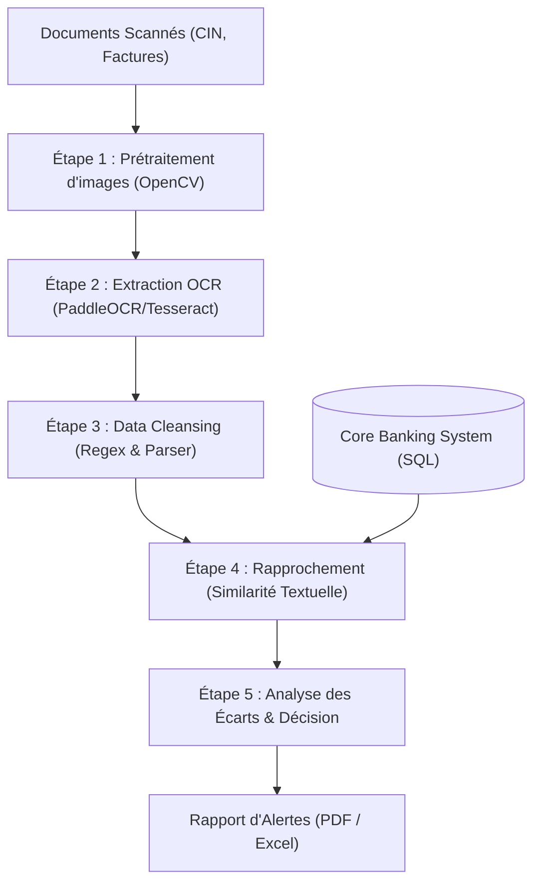

# Cadrage et Planification du Projet PFE

**Titre du projet :** Automatisation de la revue KYC : Extraction documentaire (OCR) et Rapprochement de données bancaires (Core Banking System)

---

## 1. Le Cadrage Métier & Compréhension du Problème (Business Understanding)

Avant toute ligne de code, il faut décrypter les enjeux business et les contraintes opérationnelles :

*   **L'enjeu réglementaire (KYC) :** La réglementation bancaire impose de rafraîchir les informations des clients physiques tous les **7 ans** (et **5 ans** pour les Personnes Politiquement Exposées - PPE) afin de lutter contre la fraude et le blanchiment d'argent (LCB-FT).
*   **La contrainte de volumétrie :** Traiter **30 000 dossiers par an**. Si on considère qu'un dossier contient au moins 2 à 3 documents (CIN recto/verso, facture de services publics type STEG/SONEDE, etc.), cela représente près de **100 000 documents à analyser par an**. Le traitement manuel est impossible à cette échelle pour le Back-Office, d'où le besoin d'automatisation (Revue en masse).
*   **Les contraintes d'infrastructure (Légèreté & Sécurité) :**
    *   **Pas de GPU ni de machines puissantes :** Cela élimine d'office les grands modèles d'IA générative (LLM multimodaux locaux très lourds) ou les services cloud payants. Il faut des modèles légers optimisés pour le CPU.
    *   **Secret Bancaire & Souveraineté des données :** L'usage d'API cloud publiques (Google Cloud Vision, OpenAI, AWS Textract) est interdit par la conformité bancaire car les pièces d'identité ne doivent pas quitter les serveurs de la banque. La solution doit être déployable **On-Premise** (en local).

---

## 2. L'État de l'Art & Choix Technologiques (Benchmark)

C'est la phase de recherche pour comparer les outils disponibles sans réinventer la roue. Nous analysons les technologies sous l'angle du compromis **Précision vs Vitesse sur CPU**.

### A. Moteurs d'OCR (Reconnaissance de caractères)
Nous segmentons l'étude en trois options principales :

1.  **Tesseract OCR (Google) :**
    *   *Principe :* Moteur historique basé sur des approches classiques de traitement d'image, combiné à des LSTM légers.
    *   *Avantages :* Ultra-léger, consomme très peu de CPU, rapide.
    *   *Inconvénients :* Très sensible au bruit, à la rotation et à la qualité du scan. Nécessite une étape lourde de prétraitement d'image (Binarisation, alignement via OpenCV).
2.  **PaddleOCR (Baidu) :**
    *   *Principe :* Pipeline de Deep Learning moderne (Détection de texte PP-OCRDet + Reconnaissance PP-OCRRec).
    *   *Avantages :* Version "Lightweight" extrêmement performante sur CPU. Gère parfaitement les textes inclinés, les polices complexes, et supporte très bien le multilingue (Français/Arabe, crucial pour les documents tunisiens).
    *   *Inconvénients :* Installation parfois capricieuse sous Windows (dépendances C++).
3.  **EasyOCR :**
    *   *Principe :* Basé sur PyTorch.
    *   *Avantages :* Très simple d'utilisation en Python.
    *   *Inconvénients :* Conçu pour tourner avec un GPU. En mode CPU, ses performances de vitesse sont médiocres pour un traitement batch de 30 000 clients.

### B. Algorithmes de Similarité Textuelle (Rapprochement / Matching)
Les données extraites par l'OCR comportent des erreurs de lecture (ex: `M0UHC1NE` au lieu de `MOUHCINE`, `O` lu comme `0` ou `I` comme `1`). Nous étudions les algorithmes pour comparer le texte extrait avec les données du Core Banking System (CBS) :

*   **Distance de Levenshtein :** Compte le nombre minimal d'insertions, de substitutions ou de suppressions pour passer d'une chaîne à l'autre. Utile pour détecter les fautes de frappe isolées.
*   **Indice de Jaro-Winkler :** Donne plus de poids aux caractères communs situés au début des chaînes. Excellent pour comparer des noms et prénoms (qui partagent souvent des préfixes).
*   **Fuzzy Matching (Token Sort Ratio) :** Utile pour comparer les adresses postales dont l'ordre des mots peut changer (ex: "12 Rue de Tanger, Casablanca" vs "Rue de Tanger n° 12, Casablanca").

---

## 3. Conception du Prototype (MVP) et Pipeline de Traitement

Pour structurer notre code de manière modulaire, nous dessinons l'architecture du pipeline de bout en bout :

*   **Ingestion :** Lecture des images de test.
*   **Prétraitement OpenCV :** Réduire le bruit, redresser l'image (deskewing) et augmenter le contraste pour faciliter le travail de l'OCR.
*   **OCR :** Extraction du texte brut (lignes et coordonnées).
*   **Classification Automatique du Document :** Avant toute extraction, un module de détection identifie le type de document reçu en analysant ses mots-clés caractéristiques :
    *   **CIN** (Carte d'Identité Nationale - 8 chiffres)
    *   **Passeport** (numéro alphanumérique tunisien)
    *   **Facture STEG** (Electricité/Gaz)
    *   **Facture SONEDE** (Eau) / **Facture Télécom** (Ooredoo, TT, Orange)
    *   **Fiche de paie** (Bulletin de salaire avec CNSS, IRPP)
    *   **Contrat de bail** (Justificatif de domicile)
    *   → **Script dédié :** `classification_documents.py`
*   **Nettoyage & Structuration (Data Cleansing) :** Selon le type détecté, les expressions régulières (Regex) adaptées au contexte tunisien sont appliquées pour extraire :
    *   **CIN :** N° CIN (8 chiffres), Nom, Prénom, Date et Lieu de naissance.
    *   **Passeport :** N° Passeport, Nom, Prénom, Date d'expiration.
    *   **Facture STEG/SONEDE :** Nom abonné, Adresse, Référence client, Montant TTC.
    *   **Fiche de paie :** Nom employé, CIN mentionnée, Employeur, Salaire net, Période.
*   **Matching & Règles Décisionnelles :**
    *   Calcul des scores de similarité sur le Nom, Prénom, CIN et Adresse.
    *   Définition de seuils (ex: si similarité du nom > 85% et CIN identique, alors match OK ; si similarité < 70%, lever une alerte de divergence).
*   **Reporting :** Génération d'un statut pour chaque client (Ex: *Données conformes*, *Mise à jour requise*, *Alerte usurpation/erreur*).

---

## 4. Plan de Travail Semaine par Semaine (Roadmap - 3 Mois / 12 Semaines)

Pour mener à bien ce projet de 3 mois, le planning est structuré comme suit :

### Mois 1 : Cadrage, Étude & Extraction OCR (Semaines 1 à 4)
*   **Semaine 1 :** Cadrage du projet, compréhension des processus KYC bancaires et modélisation de la base de données de simulation (CBS).
*   **Semaine 2 :** État de l'art approfondi des solutions OCR légères (Tesseract vs PaddleOCR vs EasyOCR). Analyse des contraintes CPU et installation de l'environnement de développement.
*   **Semaine 3 :** Première version du script d'extraction OCR brute. Acquisition et indexation du jeu de données de test (pièces d'identité tunisiennes, factures STEG/SONEDE).
*   **Semaine 4 :** Optimisation et prétraitement des images avec OpenCV (binarisation, réduction de bruit, redressement de l'angle) pour améliorer les performances de lecture de l'OCR sur CPU.

### Mois 2 : Nettoyage (Data Cleansing) & Algorithmes de Rapprochement (Semaines 5 à 8)
*   **Semaine 5 :** Conception et implémentation des scripts de Data Cleansing avec expressions régulières (Regex) adaptées au format tunisien (CIN à 8 chiffres, adresses tunisiennes, noms).
*   **Semaine 6 :** Analyse et benchmark théorique et pratique des mesures de similarité textuelle (distance de Levenshtein, distance de Jaro-Winkler, similarité de Jaccard).
*   **Semaine 7 :** Développement de l'algorithme de Rapprochement (Matching) entre les données extraites nettoyées et le système central (CBS).
*   **Semaine 8 :** Expérimentation et réglage fin des seuils d'écart (thresholds) de similarité pour minimiser les faux positifs et les faux négatifs.

### Mois 3 : Intégration, Validation en Masse & Clôture (Semaines 9 à 12)
*   **Semaine 9 :** Intégration du pipeline complet de bout en bout (MVP) reliant l'OCR, le Cleansing, le Rapprochement et l'écriture des résultats dans la base.
*   **Semaine 10 :** Développement du module de reporting (génération de tableaux de bord ou de rapports d'écarts automatisés).
*   **Semaine 11 :** Phase de test de montée en charge sur CPU (Batch processing) pour simuler la revue KYC de masse et optimiser les temps de traitement.
*   **Semaine 12 :** Rédaction finale du rapport de PFE et préparation de la soutenance devant le jury.
